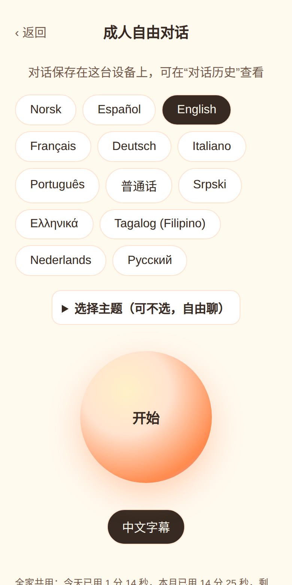
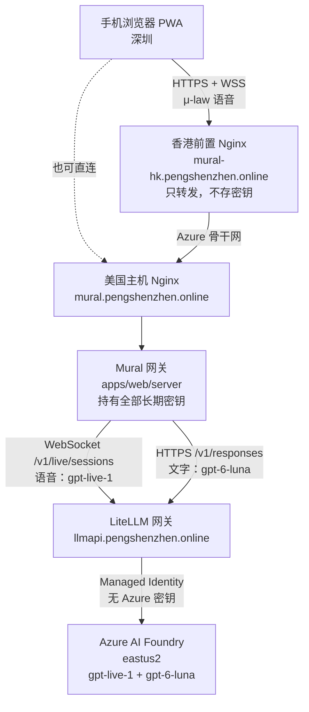
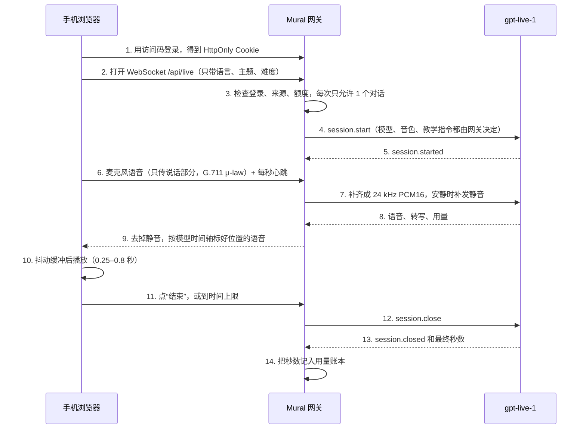

# Mural 个人版（Web/PWA）

**手机浏览器里的 AI 语言口语陪练。** 对着一个会说话的橙色光球练口语，说错了当场纠正，孩子可以跟读拿星星，家长看中文报告。

线上地址：<https://mural.pengshenzhen.online/>（访问需要访问码，仅供个人和家人使用）

本仓库是 [Chuloo/mural](https://github.com/Chuloo/mural) 的个人 Fork。上游是 iPhone 和 Android 原生 App。这个 Fork 在 `apps/web/` 新增了一个可安装的网页版（PWA），并保持原生代码不变。

<p align="center">
  
  
</p>

## 功能

| 功能 | 说明 |
| --- | --- |
| 实时语音对话 | 说话时直接回答，可以打断。每次最长 10 分钟 |
| 成人自由对话 | 13 种语言，24 个对话主题，可以搜索时事话题再聊，安静时会轻声提醒，可以继续上一次对话 |
| 孩子英语口语 | 4 个难度，23 个话题，卡住时给一句中文提示，说错先确认再纠正，孩子跟读一遍，跟读成功得星星，每 5 颗星解锁一张贴纸 |
| 家长报告 | 每次孩子对话结束后，用中文写出学到的词、纠正的错误和下次建议。家长密码保护 |
| 中文字幕、点词查义、打字回复 | 不方便说话时可以打字，Mural 会开口回答 |
| 学习记录 | 每轮评估、生词的记忆条（1–3 格）、单词卡、下次对话自动复习 |
| 对话历史与备份 | 记录保存在本机浏览器，可以导出和导入 JSON。格式与原生 App 的备份兼容 |
| 费用保护 | 单次、每天、每月、累计四道时长上限，只记录秒数 |

## 个人版语音链路架构



一次语音对话的过程：



设计要点：

- **长期密钥只在网关。** 浏览器只有一个 12 小时有效的登录 Cookie（HttpOnly、SameSite=Strict）。
- **浏览器只能发麦克风语音和几个固定指令**（结束、求助、打字）。模型、音色、教学指令、话题都由网关决定。
- **跨境网络很差也能用。** 浏览器和网关之间用 μ-law 压缩，只传说话部分，网关丢掉模型的静音，浏览器按时间轴加抖动缓冲播放。实测同样 10 秒对话，手机一侧的流量从约 1.2 MB 降到约 170 KB。
- **香港前置节点只做转发。** 不在香港保存密钥、记录或用量，所有额度仍在美国网关统一执行。

## 需要准备的模型

> 这里的模型是 Mural 对话用的 **OpenAI 模型**，在 **Azure AI Foundry** 部署。它们和 Multica 上写代码的 Claude 模型无关。

| 用途 | 模型（部署名） | 调用方式 | 没有它会怎样 |
| --- | --- | --- | --- |
| **语音对话**（必需） | `gpt-live-1`（GPT-Live，版本 `2026-09-10`） | WebSocket `/v1/live/sessions`，24 kHz 单声道 PCM16 | 不能对话 |
| **文字辅助**（建议） | `gpt-6-luna` | Responses API（`/v1/responses`） | 字幕、点词查义、打字回复、每轮评估、孩子家长报告和星星、时事话题都不可用 |

文字模型 `gpt-6-luna` 负责这些事：

- 中文字幕和点词查义。
- 打字回复。
- 每轮评估，用来更新生词记忆条。
- 孩子模式的家长报告和星星。
- 时事话题：用 `web_search` 工具搜索网页，写出摘要。这个功能要求你的网关支持 Responses API 的 `web_search` 工具。

**准备步骤：**

1. 在 Azure AI Foundry 创建资源，部署 `gpt-live-1`。部署类型为 Global Standard。据第三方统计（非微软官方，请在 Azure 门户核实），目前有 6 个区域可部署，本项目使用 eastus2。
2. 在同一资源里部署 `gpt-6-luna`。
3. 准备一个 Mural 能访问的网关。Mural 网关向 `LIVE_UPSTREAM_URL` 和 `TEXT_UPSTREAM_URL` 发送 `Authorization: Bearer <密钥>`。本项目验证过的做法是 **LiteLLM 网关**：LiteLLM 用 Managed Identity 访问 Azure，不保存 Azure 密钥，并给 Mural 一个**只允许这两个模型**的专用虚拟密钥。LiteLLM 1.106.3 不原生支持 GPT-Live，本项目的 LiteLLM 加了一个运行时补丁。
   - 不建议让 Mural 直连 Azure：直连需要 Microsoft Entra ID 令牌，约一小时过期，Mural 目前没有自动刷新。
4. 把地址和密钥写进 `.env`（见下文），**不要**提交到仓库。

**参考价格**（以 OpenAI 和 Azure 官方页面为准）：

- `gpt-live-1`：约 0.05 美元/分钟，按秒计费，不向上取整。
- `gpt-6-luna`：约 0.10 美元/百万输入 token，0.50 美元/百万输出 token。
- 来源：<https://developers.openai.com/api/docs/models/gpt-live-1>、<https://developers.openai.com/api/docs/models/gpt-6-luna>。
- 按每月最多 600 分钟语音计算，语音费用最多约 30 美元，文字模型费用很小。

## 快速开始

需要 Docker 和 Docker Compose，以及一个对公网开放 HTTPS 的域名。手机麦克风要求 HTTPS。

**1. 取得代码和配置文件**

```sh
git clone https://github.com/realercheng/mural-web.git
cd mural-web/apps/web
cp .env.example .env
chmod 600 .env
```

**2. 编辑 `.env`**

必填项：

| 变量 | 含义 |
| --- | --- |
| `PUBLIC_ORIGIN` | 网站地址，多个用逗号隔开，例如 `https://mural.example.com,https://mural-hk.example.com` |
| `LIVE_UPSTREAM_URL`、`LIVE_UPSTREAM_KEY` | 语音模型的 WebSocket 地址和密钥 |
| `ACCESS_CODE` | 登录访问码，至少 16 个字符 |
| `SESSION_SECRET` | Cookie 签名密钥，至少 32 个字符 |

可选项（有默认值）：

| 变量 | 默认值 | 含义 |
| --- | --- | --- |
| `TEXT_UPSTREAM_URL`、`TEXT_UPSTREAM_KEY`、`TEXT_MODEL` | 空、空、`gpt-6-luna` | 文字模型。不填 `TEXT_UPSTREAM_URL` 就关闭文字辅助 |
| `LIVE_MODEL`、`LIVE_VOICE` | `gpt-live-1`、`marin` | 语音模型和音色 |
| `MAX_SESSION_SECONDS` | 600 | 单次对话上限 |
| `DAILY_LIMIT_SECONDS` | 1200 | 每天上限，按 `USAGE_TIME_ZONE` 计日 |
| `MONTHLY_LIMIT_SECONDS` | 36000 | 每月上限 |
| `TOTAL_LIMIT_SECONDS` | 2400 | 累计上限，作为兜底 |
| `IDLE_AUDIO_SECONDS` | 10 | 这么久收不到麦克风信号就结束对话 |
| `HELPER_PER_MINUTE`、`HELPER_DAILY_LIMIT` | 20、1000 | 文字辅助的调用次数上限 |
| `TOPIC_DAILY_LIMIT` | 10 | 每天搜索时事的次数，0 为关闭 |
| `CHECK_IN_SECONDS` | 15 | 对方安静多久后提醒一次，0 为关闭 |
| `TRUST_PROXY` | `false` | 在 Nginx 之后运行时设为 `true` |
| `USAGE_TIME_ZONE` | `Asia/Shanghai` | 计日和计月的时区 |

**3. 用 Docker Compose 启动**

在 `apps/web/` 下新建 `docker-compose.yml`：

```yaml
name: mural
services:
  web:
    build: .
    image: mural-web:local
    restart: unless-stopped
    env_file: .env
    ports:
      - "127.0.0.1:18090:8080"
    volumes:
      - ./data:/data
    read_only: true
    tmpfs:
      - /tmp
    cap_drop: [ALL]
    security_opt:
      - no-new-privileges:true
```

```sh
docker compose up -d --build
curl http://127.0.0.1:18090/api/health   # 返回 {"ok":true}
```

镜像构建时会先运行全部测试，测试失败就不会生成镜像。

**4. 用 Nginx 发布到公网**

反向代理要转发 WebSocket，并传入真实客户端地址：

```nginx
map $http_upgrade $connection_upgrade { default upgrade; '' close; }

server {
    listen 443 ssl;
    server_name mural.example.com;
    # ssl_certificate 和 ssl_certificate_key 用 certbot 生成

    location / {
        proxy_pass http://127.0.0.1:18090;
        proxy_http_version 1.1;
        proxy_set_header Upgrade $http_upgrade;
        proxy_set_header Connection $connection_upgrade;
        proxy_set_header Host $host;
        proxy_set_header X-Real-IP $remote_addr;
        proxy_read_timeout 900s;
        proxy_buffering off;
    }
}
```

**5. 在手机上使用**

1. 用手机浏览器打开你的网址，输入访问码。
2. 把页面“添加到主屏幕”，像 App 一样使用。
3. 点“孩子英语口语”或“成人自由对话”，允许麦克风，开始说话。

**加一个离用户更近的前置节点（可选）。** 如果用户到源站的网络很差，可以在更近的地区放一台只运行 Nginx 的主机，反向代理到源站，并把前置地址加进源站的 `PUBLIC_ORIGIN`。前置节点不需要任何密钥。

## 本地开发

需要 Node.js 22.19 或更高版本。

```sh
cd apps/web
npm ci
cp .env.example .env
npm test           # 69 项测试，使用本地假的语音服务，不产生费用
npm run check      # TypeScript 类型检查
npm run build
node --env-file=.env dist-server/main.js
```

`npm run dev` 用 Vite 提供界面，并把 `/api` 转发到本机 8080 端口的网关。

## 费用和隐私

- **时长上限分四层**：单次、每天、每月、累计。到达任何一层，网关就拒绝新对话。秒数以模型返回的最终用量为准；没有收到时按连接时长估算，宁多勿少。
- **同一时间只允许 1 个对话。**
- **网关只保存用量。** 每次对话的秒数和结束原因写入 `data/usage.json`。日志里只有事件名、时长和固定原因，没有语音、文字、Cookie 和密钥。
- **对话内容只在你的浏览器里。** 历史、孩子档案、星星和学习记录保存在浏览器的 IndexedDB 和 localStorage，不上传。
- **孩子对话结束时有一个例外。** 为了生成家长报告，网关把转写暂存在内存里，只发送一次给文字模型。报告成功或 30 分钟后丢弃，不写入磁盘。
- **清除网站数据会删除学习记录。** 请定期在“对话历史”里导出备份。

## 当前验证状态

已验证：

- 自动测试 69 项全部通过，类型检查通过。
- 用真实 `gpt-live-1`（经 LiteLLM 网关）完成了多次端到端对话。
- 在 iPhone 和 Android 平板上完成真机对话，从深圳经香港前置访问时流畅。
- 孩子模式、对话历史与备份、字幕、点词查义、打字回复、学习记录、13 种语言和 24 个主题，都已通过真机验收。

尚未验证：

- 时事话题搜索依赖网关支持 `web_search` 工具。验收记录中没有单独确认。如果界面显示“搜索没有成功”，说明网关不支持。
- 荷兰语和俄语的开场与纠错指令是为 Web 版补写的，没有经过母语者审核（当前决定暂不审核）。
- iPhone 锁屏和切后台时的行为没有逐项验收。
- 普通话拼音没有实现。浏览器没有拼音接口，需要另行引入词典库。

## 已知限制

- 手机浏览器在锁屏或切到后台时，可能停止麦克风。网关会在 `IDLE_AUDIO_SECONDS` 后结束对话。网页做不到原生 App 那样的后台通话。
- 外放时的回声消除取决于浏览器，需要在真机上确认。
- 星星、报告和评估依赖语音识别和文字模型，可能有错。它们用来引导练习，不是成绩。
- 学习记录只在一台设备的一个浏览器里，不会自动同步。换设备请用导出和导入。

## 代码结构

| 路径 | 内容 |
| --- | --- |
| `apps/web/` | 网页版：React + TypeScript + Vite 界面，Node.js 网关（`server/`），Dockerfile。详细的技术说明见 [`apps/web/README.md`](apps/web/README.md)（英文） |
| `apps/web/server/src/live.ts` | 语音中继：额度、静音补发、抖动缓冲时间轴、提醒、求助、语言纠偏 |
| `apps/web/server/src/wire.ts` | 浏览器和网关之间的二进制语音格式 |
| `apps/web/server/src/kids.ts` | 孩子模式的话题和教学指令 |
| `apps/web/server/src/content/languages.v1.json` | 13 种语言和 24 个主题，由 Swift 语言模块导出 |
| `apps/web/src/` | 界面：成人模式、孩子模式、家长页、历史、学习、备份 |
| `apps/ios/`、`apps/android/`、`services/api/`、`shared/`、`scripts/` | 上游原生 App 和服务，本 Fork 不修改。Web 版的语言内容和学习规则由这里移植而来 |

修改 `apps/ios/Core/Languages/` 里的语言模块后，运行 `python3 scripts/export_android_content.py`，同时更新 Android 和 Web 的内容。

## 工作方式

所有改动先进入本 Fork 的分支，用拉取请求（PR）审阅后再合并到 `main`。上游 [Chuloo/mural](https://github.com/Chuloo/mural) 只用来参考和同步。长期模型密钥不进入浏览器，也不进入仓库。

## 与上游原生 App 的关系

上游 Mural 是 iPhone（SwiftUI）和 Android（Jetpack Compose）原生 App，直接使用你自己的 OpenAI API 密钥，学习记录保存在手机上。原生部分的说明保持上游原样：

- [Android 构建说明](apps/android/README.md)
- [iPhone 安装说明](docs/run-on-iphone.md)、[Android 安装说明](docs/run-on-android.md)
- [语言架构](docs/language-architecture.md)、[如何添加语言](docs/add-language.md)
- [隐私和安全](SECURITY.md)、[贡献指南](CONTRIBUTING.md)

原生文档里的网址和账号信息属于上游项目，不代表本 Fork 的网站。

## 许可证

本项目沿用上游的 [MIT 许可证](LICENSE)。第三方组件保留各自的许可证。Mural 的名称和图标属于原项目，许可证不授予商标权。
